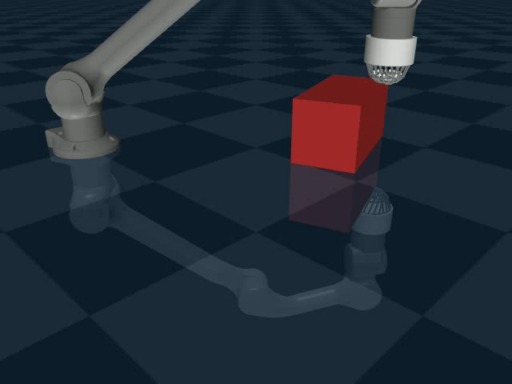
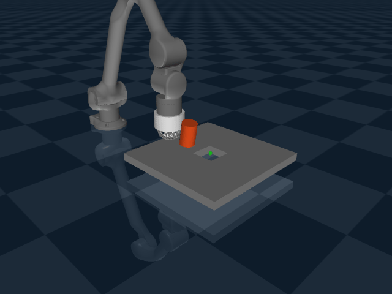
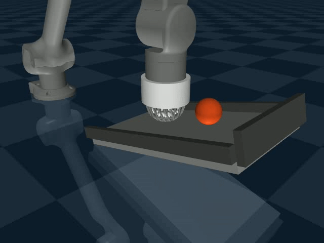
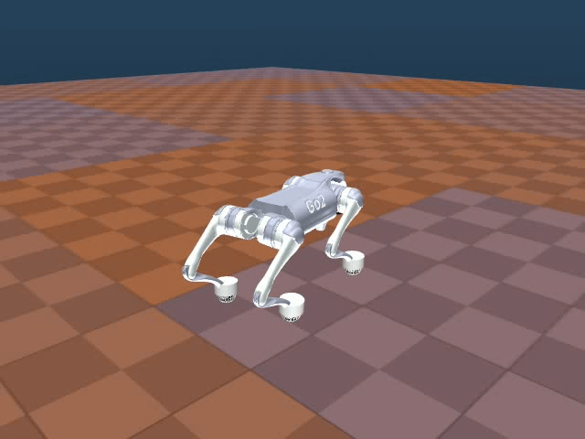
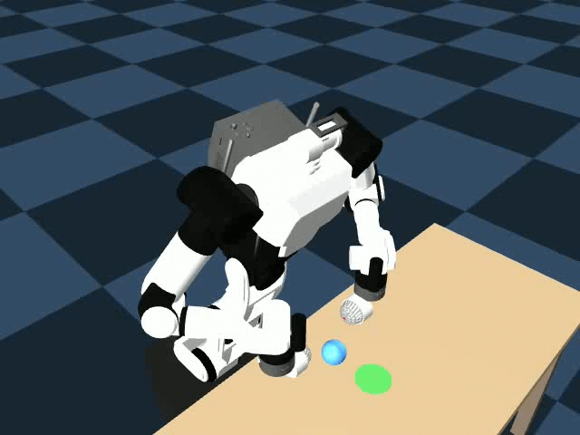
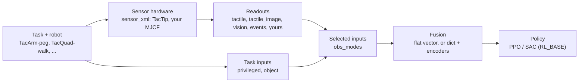

# TacTip-gym

A MuJoCo simulation of the TacTip tactile sensor (based on the <a href="https://github.com/shepai/Robot_foot">robot foot repo</a>), and a Gymnasium benchmark for testing **tactile, visual-tactile and visual sensing** on several robots: a robot arm, a quadruped and a wheeled humanoid.
<table>
  <tr>
    <td align="center">
      <br>
    </td>
    <td align="center">
      <br>
    </td>
  </tr>
  <tr>
    <td align="center">
      <br>
    </td>
    <td align="center">
      <br>
    </td>
  </tr>
  <tr>
    <td align="center">
      <br>
    </td>
    <td align="center">
      <br>
    </td>
  </tr>
</table>

The simulator models the TacTip's silicone skin as a mesh of points with a flexible structure, so the sensor deforms like a soft body. Our <a href="https://shepai.github.io/tutorials/softbodies.html">tutorial page</a> explains how this was built.


The benchmark is built so that a researcher changes **what is being tested** through configuration rather than code. Each of these is chosen independently:

| You choose | How | Default |
|------------|-----|---------|
| The task and robot | the Gym id, e.g. `TacArm-peg`, `TacQuad-walk`, `TacHumanoid-pick` | |
| The sensor hardware mounted on the robot | `sensor_xml=` a registered name or a stand-alone MJCF file | the TacTip |
| How the sensor is read (readouts) | `sensors={key: readout}`: change, add or remove inputs | markers, in-sensor camera, robot camera, taxel events |
| What the policy gets (inputs) | `obs_modes=["tactile", "vision", ...]` | privileged state only |
| How the inputs are fused | `obs_format="flat"` / `"dict"`, pretrained `encoders=` | one flat vector |
| Task constants (geometry, gains, rewards) | `overrides={"TIP_R": 0.03}` | the class constants |
| All of the above, plus training | one YAML / JSON experiment file, with variants | |



## Contents

- [Installation](#installation)
- [Quick start](#quick-start)
- [Tasks](#tasks)
- [Choosing what the policy senses](#choosing-what-the-policy-senses)
- [Sensor hardware](#sensor-hardware)
- [Experiment configs](#experiment-configs)
- [Adding your own sensor](#adding-your-own-sensor)
- [Training](#training)
- [Visuo-tactile pipeline](#visuo-tactile-pipeline)
- [Event-based tactile layer (taxels)](#event-based-tactile-layer-taxels)
- [Arm tasks in detail](#arm-tasks-in-detail)
- [Quadruped and humanoid](#quadruped-and-humanoid)
- [Tests](#tests)
- [Training tips](#training-tips)
- [Adding your own task](#adding-your-own-task)
- [Project layout](#project-layout)

## Installation

Navigate to the folder where you downloaded the repo and run:

```bash
pip install -e .              # the environments: mujoco, gymnasium, numpy
pip install -e ".[train]"     # + training: stable-baselines3, torch, opencv, tqdm, rich, pyyaml
pip install -e ".[test]"      # + pytest
pip install -e ".[legacy]"    # + dm_control, only needed for the old env.physics attribute
```

For GPU training on Windows, install PyTorch from the selector at [pytorch.org](https://pytorch.org) **before** `pip install -e ".[train]"`; a plain `pip install torch` gives the CPU-only build there.

The camera inputs and the training videos render offscreen. On a Linux machine without a display, set `MUJOCO_GL=egl` before running.

The mesh files are large and are kept out of some copies of the repo. They go here:

| Files | Needed for |
|-------|------------|
| `src/tactip_mujoco_gym/assets/robotarm/assets/z1_Link0*.stl` | every `TacArm-*` task (Unitree Z1) |
| `src/tactip_mujoco_gym/assets/go2.xml` (or any `go2.xml` under `assets/`) and `assets/go2/*.obj` | `TacQuad-walk` (Unitree Go2, from [MuJoCo Menagerie](https://github.com/google-deepmind/mujoco_menagerie)) |
| `src/tactip_mujoco_gym/assets/rby1/` with its `assets/` meshes | `TacHumanoid-pick` (Rainbow Robotics RB-Y1, from MuJoCo Menagerie) |
| `encoders/*.pt` | pretrained visuo-tactile encoders (made by `train_encoders.py`) |

## Quick start

See what is available, then build a task and look at its inputs:

```bash
python -m tactip_mujoco_gym list                     # tasks, sensor readouts, sensor hardware
python -m tactip_mujoco_gym describe TacArm-peg      # its inputs, whether each is available, shapes
```

(`tactip-gym list` does the same once the package is installed.)

Run a task with random actions in the MuJoCo viewer:

```python
import time
import gymnasium as gym
import mujoco.viewer
import tactip_mujoco_gym  # registers the tasks

env = gym.make("TacArm-peg", obs_modes=["tactile", "vision"])
raw = env.unwrapped
obs, info = env.reset(seed=0)
dt = raw.FRAME_SKIP * raw.model.opt.timestep    # 0.02 s per step

with mujoco.viewer.launch_passive(raw.model, raw.data) as viewer:
    while viewer.is_running():
        action = env.action_space.sample()
        obs, reward, terminated, truncated, info = env.step(action)
        viewer.sync()
        time.sleep(dt)
        if terminated or truncated:
            print("success" if info["is_success"] else "episode over")
            obs, info = env.reset()
```

`info` contains `is_success` and `fail_reason`, plus task details such as `goal_dist`, `touching`, `friction` or `laps`.

To look at the hand camera, or the camera inside the sensor:

```python
import cv2
cv2.imshow("handcam", cv2.cvtColor(raw.get_camera(), cv2.COLOR_RGB2BGR))             # uint8 RGB, 640 x 480
cv2.imshow("sensor_cam", cv2.cvtColor(raw.get_tactile_image(), cv2.COLOR_RGB2BGR))   # float32 in [0, 1]
cv2.waitKey(1)
```

Train a set of comparisons from a config file:

```bash
python -m tactip_mujoco_gym train configs/peg_sensing.yaml --dry-run          # show the runs
python -m tactip_mujoco_gym train configs/peg_sensing.yaml --variant tactile   # train one
```

## Tasks

| Gym ID | Robot (sensor mounts) | Goal | Action | Episode | Success |
|--------|-----------------------|------|--------|---------|---------|
| `TacArm-edge` | Z1 arm (1: `tip`) | Start touching the top edge of a randomly rotated block and follow it all the way round | 3 (x, y, z) | 400 steps (8 s) | One full anticlockwise lap |
| `TacArm-peg` | Z1 arm (1: `tip`) | Start touching an upright cylinder and push it into a hole | 2 (x, y) | 250 steps (5 s) | Cylinder drops into the hole |
| `TacArm-shape` | Z1 arm (1: `tip`) | Start touching one of four shapes and push it into its own hole | 2 (x, y) | 300 steps (6 s) | Shape goes into the correct hole |
| `TacArm-hill` | Z1 arm (1: `tip`) | Intercept a ball rolling down a ramp whose friction changes each episode, then push it to the top | 2 (along / across the slope) | 300 steps (6 s) | Ball within 4 cm of the top |
| `TacQuad-walk` | Go2 quadruped (4: `FL` `FR` `RL` `RR`) | Follow velocity commands over tiles whose friction, softness, bounce and roughness change | 12 joint targets | 1000 steps (20 s) | Still up at the end |
| `TacHumanoid-pick` | RB-Y1 wheeled humanoid (2: `left` `right`) | Squeeze-grasp a soft or rigid object between the two sensors, carry it to a target, put it down | 7 (bimanual) or 9 (independent) | 1000 steps (20 s) | Object resting on the target, hands off |
| `RobotArm-v0` | Z1 arm | The arm and sensor with the task controller and no task (zero reward, never ends) | 3 | | |
| `RandomTac-v0` | the sensor alone | Boxes dropped on a standalone TacTip; observation `{"image": in-sensor camera}` (original API) | none | | |

The policy runs at 50 Hz on every task. `python -m tactip_mujoco_gym list` prints this table with each task's own options.

Keyword arguments every robot takes through `gym.make(...)`:

| Argument | Default | Meaning |
|----------|---------|---------|
| `obs_modes` | privileged only | Which inputs to use: `["tactile", "vision"]`, `"tactile+vision"` or `{"tactile": True, ...}` (keys left out count as `False`) |
| `obs_format` | `"flat"` | `"flat"`: one long vector. `"dict"`: one key per input |
| `sensors` | | Change, add or remove readouts (below) |
| `sensor_xml` | the TacTip | The sensor hardware (below) |
| `sensor_stiffness` | 1 (arm), 10 (quadruped, humanoid) | Multiplies the sensor's joint and tendon stiffness, damping and armature |
| `overrides` | | `{"CONSTANT": value}` for any of the env's UPPER_CASE class constants, on this instance only |
| `max_steps` | per task | Override the episode length |
| `privileged` | | Earlier shortcut: `True` = privileged only, `False` = tactile only. Ignored if `obs_modes` is given |

Task options:

| Argument | Task | Default | Meaning |
|----------|------|---------|---------|
| `events` | arm | `False` | Add taxel events (same as `"events"` in `obs_modes`) |
| `start_touching` | peg, shape | `True` | Start in contact with the object |
| `spawn_yaw` | shape | `0.1` | Starting rotation range in radians (pi = needs re-orienting) |
| `spawn_toward_hole` | shape | `0.0` | 0 = start in the middle, 1 = start in line with the correct hole |
| `observe_friction` | hill | `False` | Add the true friction level to the privileged input |
| `feet` | quadruped | `"tactip"` | `"tactip"`, `"proxy"` (a sphere of the sensor's size: same legs, much faster, no touch) or `"rigid"` (the Go2's own feet) |
| `terrain_level`, `curriculum` | quadruped | `None`, `True` | Fixed difficulty 0..1, or a curriculum that adapts per environment |
| `command` | quadruped | `None` | `None` = random commands, or a fixed `(vx, vy, yaw_rate)` |
| `objects`, `level`, `curriculum` | humanoid | all, `None`, `True` | Objects to draw from, fixed difficulty or curriculum |
| `action_mode` | humanoid | `"bimanual"` | `"bimanual"` (grasp centre, width and yaw) or `"independent"` (each hand) |

## Choosing what the policy senses

### Inputs

Every observation starts with a short **proprioception** block, because a real robot always knows its own state (the arm: tip position, commanded minus measured tip position, smoothed velocity command; the quadruped: IMU, joints, command, last action; the humanoid: hands, base, target). On top of it, any combination of these inputs can be switched on:

| Input | From | Contents | Arm | Quadruped | Humanoid |
|-------|------|----------|-----|-----------|----------|
| `privileged` | task | The true task state (object pose, goal vector, ground properties, ...) | 12 to 17 | 65 | 35 (incl. `object`) |
| `object` | task | What a camera-based object tracker would give | | | 29 |
| `tactile` | readout `tactip_markers` | Marker displacement from rest and change since the last step, in mm, every mount | 426 | 1,704 | 852 |
| `tactile_image` | readout `tactip_camera` | Image from the camera inside each TacTip, stacked along channels | 64 × 64 × 3 | 64 × 64 × 12 | 64 × 64 × 6 |
| `vision` | readout `camera` | The robot's camera (`handcam` / `headcam`) | 64 × 64 × 3 | 64 × 64 × 3 | 64 × 64 × 3 |
| `events` | readout `taxel_events` | Event counts from the touch grids on the objects | one per taxel | | |
| yours | your readout | Anything you add with `sensors=` | | | |

Sizes are for the 71-marker TacTip and the default camera settings. `python -m tactip_mujoco_gym describe <task>` prints the inputs a task offers, whether each one is available with the current hardware (a markerless sensor has no `tactile`, `feet="proxy"` has no sensor at all) and the observation shapes.

```python
env = gym.make("TacArm-peg", obs_modes=["vision", "tactile"])                   # privileged off
env = gym.make("TacArm-peg", obs_modes=["tactile_image"], obs_format="dict")    # visual tactile

env.unwrapped.set_obs_modes(["vision"])          # a list or dict is a full selection
env.unwrapped.set_obs_modes(tactile=True)        # keywords change only those inputs
env.unwrapped.set_obs_format("dict")
env.unwrapped.set_privileged(False)              # earlier API, still works: tactile only
```

Each of these rebuilds the observation space from a real observation, so its size can never get out of step with what `step()` returns. Call them before wrapping the env in a `VecEnv` or `VecNormalize`. For vectorised training, pass `obs_modes` through `run()`, `env_kwargs` or a config file instead.

Privileged mode is the quickest way to check that a task, reward and controller can be learned at all. Tactile and vision are the settings a real robot faces.

### Observation format and fusion

In the default `"flat"` format the selected parts are joined into one vector, in the order proprio, task inputs, then sensor inputs (`tactile`, `tactile_image`, `vision`, `events`, then any you added), with images scaled to 0 to 1. In the `"dict"` format each part keeps its own key, and images stay `uint8` with shape (H, W, C), which is what Stable-Baselines3's `MultiInputPolicy` expects. Fusion options in `RL_BASE.run()`:

| Setting | What fuses the inputs |
|---------|-----------------------|
| `obs_format="flat"` | `MlpPolicy` on the whole vector (early fusion) |
| `obs_format="dict"` | `MultiInputPolicy`: SB3 runs a small CNN on each image input and an MLP on the rest, then joins them |
| `encoders="encoders/peg_vt.pt"` | `VisuoTactilePolicy`: pretrained encoders per input, then an MLP (late fusion; see the visuo-tactile pipeline) |
| `encoders="scratch"` | the same networks without pretraining |

Each readout says which encoder `VisuoTactilePolicy` gives it (`encoder = "mlp"`, `"cnn"` or `None` for pass-through), so an input you add gets one too.

### Readouts

A **readout** turns the simulation into one input. The built-in ones work on every robot and on every mount (the arm's one sensor, four feet, two hands):

| Readout | Default key | Arguments (all optional) |
|---------|-------------|--------------------------|
| `tactip_markers` | `tactile` | `marker_prefix` (`"s_c"`), `frame_site` (`"ee_site"`), `scale` (1e-3 = mm), `clip` (20), `velocity` (True) |
| `tactip_camera` | `tactile_image` | `camera` (`"sensor_cam"`), `width`, `height` (64), `mode` (`"rgb"` / `"gray"`), `groups` ((2,): the pins only) |
| `camera` | `vision` | `camera` (`VISION_CAMERA`), `width`, `height` (64), `mode` (`"rgb"` / `"gray"` / `"depth"`), `max_depth`, `shadows`, `antialias` |
| `taxel_events` | `events` | `prefix` (`"tx_"`), `threshold` (0.02 N), `clip` (5) |

`sensors=` changes them per environment:

```python
gym.make("TacArm-peg", sensors={"tactile": {"clip": 10}})                  # tweak a default (type kept)
gym.make("TacArm-peg", sensors={"vision": {"width": 96, "height": 96, "mode": "depth"}})
gym.make("TacArm-peg", sensors={"wrist": {"type": "camera", "camera": "my_cam"}},
         obs_modes=["tactile", "wrist"])                                    # a second camera as a new input
gym.make("TacArm-peg", sensors={"force": "mypackage.sensors:WristForce"},
         obs_modes=["force"])                                               # your own readout
gym.make("TacArm-peg", sensors={"tactile_image": None})                     # remove an input
```

A readout can be given as a registered name, a `"package.module:ClassName"` path (also found inside `SubprocVecEnv` workers on every platform), a dict `{"type": ..., **arguments}`, or a `Sensor` instance (copied for each environment, so several environments never share one). The vision camera's defaults also come from class constants (`VISION_CAMERA`, `VISION_WIDTH`, `VISION_HEIGHT`, `VISION_MODE`, `VISION_MAX_DEPTH`), so `overrides={"VISION_WIDTH": 96}` works too. Keep images small: in the flat format every pixel is an input, and SB3's default CNN needs at least 36 × 36.

The vision input has its own small renderer. For viewing or recording at full size, use `get_camera()`, which keeps a separate renderer:

```python
img = env.unwrapped.get_camera()                                   # handcam, 640 x 480, uint8 RGB
depth = env.unwrapped.get_camera("depth", width=320, height=240)   # float32, metres
```

## Sensor hardware

`sensor_xml=` chooses the sensor model mounted on the robot: a registered name (`"tactip"`), a path to a stand-alone MJCF file, or an `MjSpec`. One file holds just the sensor, with its root body first in `<worldbody>`; its tendons, equalities and contact excludes come with it. Every element is renamed with the mount's prefix when it is attached (`sensor_`, `FL_`, `left_`, ...), so the same file can be mounted several times.

```python
gym.make("TacArm-peg", sensor_xml="examples/custom_sensor/rigid_pad.xml", obs_modes=["privileged"])
gym.make("TacQuad-walk", sensor_xml="my_tactip_variant.xml", obs_modes=["tactile"])
gym.make("TacArm-peg", sensor_stiffness=3.0, obs_modes=["tactile"])            # stiffer skin
```

Where the sensor goes on each robot:

- **Arm.** The TacTip is written into the scene files, and with `sensor_xml=None` (and `sensor_stiffness=1`) they load exactly as before. Otherwise the built-in TacTip (every body under `sensor_root`, with its tendons, equalities and contact excludes) is cut out of the scene and the chosen sensor is attached to `link06`, turned so that its tip points the way the TacTip's did and moved so that the two tips coincide. The arm's `ee_site` (the point the controller moves) and hand camera stay where they are. `sensor_xml="tactip"` rebuilds the arm with the stand-alone TacTip, which should behave like the built-in one: a good first check that sensor swapping works on your machine.
- **Quadruped.** One copy on each foot, with its tip where the original foot touched the ground (`TIP_DIRECTION`, `LEG_EXTENSION`, `SENSOR_SPIN`). `feet="proxy"` uses a sphere with the sensor's size and mass instead.
- **Humanoid.** One copy as each palm, mounted on the side of the wrist so the two face each other.

How the tip is found, in order of preference:

1. A site named **`sensor_tip`** in the sensor file: its position is the tip and its z axis points out of the sensing surface, e.g. `<site name="sensor_tip" pos="0 0 0.024" zaxis="0 0 1"/>`. A sensor without TacTip markers needs this.
2. TacTip-style marker sites (`s_c*`): a dome is fitted to them.

`"tactip"` is `assets/sensor/tactip.xml` if that file exists, and otherwise the TacTip is extracted from `assets/tactip_arm.xml` each time a process starts. Write the file once to skip that:

```bash
python -m tactip_mujoco_gym.sensor_tools extract src/tactip_mujoco_gym/assets/tactip_arm.xml \
       --out src/tactip_mujoco_gym/assets/sensor/tactip.xml
python -m tactip_mujoco_gym.sensor_tools info my_sensor.xml     # tip, axis, reach, radius, markers, mass
```

Register a model to use it by name (`register_sensor_model("my_gelsight", "path/to/gelsight.xml")`). Constants that depend on the sensor's shape (`TIP_R`, `PUSH_Z`, `Incline.TIP_H`) may need `overrides`; `check_envs.py` measures the sensor radius at the pushing height and tells you:

```bash
python -m tactip_mujoco_gym.check_envs TacArm-peg --sensor-xml my_sensor.xml
```

## Experiment configs

One YAML (or JSON) file says what is being tested: the task, robot options, sensor hardware, readouts, inputs, fusion and training settings. `variants` turn one file into a set of comparisons, each merged over the base (dicts merge, everything else replaces).

```yaml
# configs/peg_sensing.yaml (shortened)
name: peg
env: TacArm-peg
env_kwargs: {start_touching: true}
train: {algo: PPO, steps: 3000000}
variants:
  privileged:    {obs_modes: [privileged]}
  tactile:       {obs_modes: [tactile]}
  tactile_image: {obs_modes: [tactile_image], obs_format: dict}
  vision:        {obs_modes: [vision], obs_format: dict}
  visuotactile:  {obs_modes: [tactile, vision], obs_format: dict}
  visuotactile_pretrained:
    obs_modes: [tactile, vision]
    obs_format: dict
    policy: {encoders: encoders/peg_vt.pt, freeze_encoders: true}
```

```bash
python -m tactip_mujoco_gym train configs/peg_sensing.yaml                      # every variant in turn
python -m tactip_mujoco_gym train configs/peg_sensing.yaml --variant tactile vision
python -m tactip_mujoco_gym train configs/peg_sensing.yaml --dry-run            # print the runs only
python -m tactip_mujoco_gym evaluate configs/peg_sensing.yaml --episodes 50
python -m tactip_mujoco_gym visualise configs/peg_sensing.yaml --variant tactile
python -m tactip_mujoco_gym describe configs/peg_sensing.yaml --variant vision  # inputs and shapes
```

Each run is named `<name>_<variant>` and saved as `models/<name>_<variant>.zip` (see [Training](#training)).

| Key | Meaning |
|-----|---------|
| `name`, `description` | Run name (default `<env>_<inputs>`) and free text |
| `env` | Task id |
| `env_kwargs` | Task and robot options, e.g. `{feet: proxy}` |
| `sensor_xml`, `sensor_stiffness` | Sensor hardware. Relative paths are relative to the config file |
| `sensors` | Readouts, as in `sensors=` above |
| `obs_modes`, `obs_format` | Inputs and format |
| `overrides` | Class constants |
| `policy` | `encoders` (`null`, `scratch` or a checkpoint) and `freeze_encoders` |
| `train` | `algo`, `steps`, `n_envs`, `seed`, `algo_kwargs`, `record_video`, `video_every_percent`, `video_seconds`, `checkpoint_every` |
| `evaluate` | `episodes`, `deterministic`, `seed` |
| `imports` | Modules to import first, e.g. one that registers your readout |
| `variants` | `{name: {any of the keys above}}` |

Unknown keys are an error, so a typo fails at once instead of being ignored. The example configs:

| File | Compares |
|------|----------|
| `configs/peg_sensing.yaml` | Every sensing modality on the peg task, including frozen pretrained encoders |
| `configs/sensor_hardware.yaml` | The built-in TacTip, the same TacTip attached in code, a stiffer skin, and the custom pad below |
| `configs/edge_tactile.yaml` | A single run with a tweaked readout |
| `configs/quadruped_touch.yaml` | Privileged teacher, blind and touch on proxy and TacTip feet |
| `configs/humanoid_touch.yaml` | Object tracker vs tracker + touch vs camera + touch |

From Python:

```python
from tactip_mujoco_gym.experiment import load_config, make_env, train
cfg = load_config("configs/peg_sensing.yaml")
env = make_env(cfg, variant="tactile")
train(cfg, variant="tactile")
```

## Adding your own sensor

A simulated sensor is two independent parts, and you can supply either or both:

1. **Hardware**: a stand-alone MJCF file with the sensor's bodies (and a `sensor_tip` site if it has no TacTip markers). Mount it with `sensor_xml=`.
2. **A readout**: a small class that turns the simulation into an observation. Add it with `sensors=`.

`examples/custom_sensor/` does both: `rigid_pad.xml` is a markerless rigid pad, and `pad_contact.py` reads the net contact force and contact point on each mounted copy.

```python
import mujoco
import numpy as np
from tactip_mujoco_gym.sensors import Sensor, SensorUnavailable, register_sensor, subtree_geoms

@register_sensor("pad_contact")
class PadContact(Sensor):
    """Net contact force on each mounted sensor ..."""
    key = "contact"          # default observation key
    encoder = "mlp"          # VisuoTactilePolicy gives it an MLP encoder (None = pass through)

    def __init__(self, tip_site="sensor_tip", force_scale=1.0):
        self.tip_site = tip_site                 # store constructor arguments under the same
        self.force_scale = force_scale           # names, so the run's config can rebuild it

    def bind(self, env):                         # once, after the model is compiled
        for mount in env.sensor_mounts:          # one per copy of the hardware
            geoms = subtree_geoms(env.model, mount.body)
            if geoms.size == 0:
                raise SensorUnavailable("no colliding geoms on the sensor")
            ...

    def observe(self, env):                      # once per env step
        ...
        return np.array(..., dtype=np.float32)
```

```python
env = gym.make("TacArm-peg", sensor_xml="examples/custom_sensor/rigid_pad.xml",
               sensors={"contact": PadContact()}, obs_modes=["contact"],
               overrides={"TIP_R": 0.02})
```

```bash
python examples/custom_sensor/pad_contact.py           # from the repo root: run it with the scripted controller
```

The life cycle a readout can hook into (all optional except `observe`):

| Method | When |
|--------|------|
| `bind(env)` | Once, after the model is compiled: look up ids. Raise `SensorUnavailable(reason)` if this model can't support it; the env only complains if the input is selected |
| `calibrate(env, data)` | With the sensor untouched: record a rest state |
| `on_select(env, active)` | The input was switched on or off |
| `reset(env)` | Start of every episode, after the scene and robot are placed |
| `physics_step(env)` | After every physics step while active, if the class sets `substeps = True` (e.g. event sensors) |
| `env_step(env)` | After the physics of every env step, while active |
| `observe(env)` | Returns the observation |
| `flatten(value)`, `space(value)` | How it goes into the flat vector, and its Gymnasium space (defaults from the dtype: `uint8` = image) |
| `close()` | Release renderers |

Everything a readout needs is on `env`: `env.model` and `env.data` (MuJoCo), `env.sensor_mounts` (one `Mount(name, prefix, body, frame)` per copy of the hardware: element names are `prefix + name`, `body` is the copy's root body, `frame` its reference frame) and the env's constants. `tactip_mujoco_gym.sensors` also has `frame_pose`, `subtree_bodies` and `subtree_geoms`.

To share readouts as a package, add an entry point and they register themselves when `tactip_mujoco_gym` looks them up:

```toml
[project.entry-points."tactip_mujoco_gym.sensors"]
my_sensor = "my_package.sensors:MySensor"
```

Then check it: `python -m tactip_mujoco_gym describe TacArm-peg --sensor-xml my_sensor.xml --sensors '{"mine": "my_package.sensors:MySensor"}'`, `check_envs.py` with `--sensor-xml`, and a short training run with `--steps`.

## Training

`RL_BASE.py` wraps Stable-Baselines3; the config files and the scripts in `examples/RL tasks/` both use it.

| File | Purpose |
|------|---------|
| `src/tactip_mujoco_gym/RL_BASE.py` | `run()`, `evaluate()`, `visualise()`, `load_policy()` and the training-video callback |
| `src/tactip_mujoco_gym/experiment.py` | Config files and variants on top of `run()` |
| `examples/RL tasks/edge_following.py`, `peg_insertion.py`, `shape_insertion.py`, `incline_ball.py` | One script per arm task: set `OBS_MODES`, `OBS_FORMAT` and the step count, then run |
| `examples/RL tasks/quadruped_walk.py`, `humanoid_pick.py` | The quadruped and humanoid, with their own PPO settings (the humanoid adds a scripted-demo warm start) |
| `src/tactip_mujoco_gym/check_envs.py`, `check_quadruped.py`, `check_humanoid.py` | Checks each task before training (see below) |
| `examples/RL tasks/collect_dataset.py`, `train_encoders.py`, `visuotactile_train.py` | The visuo-tactile pipeline (see below) |

```python
from tactip_mujoco_gym.RL_BASE import run, evaluate, visualise

if __name__ == "__main__":          # required: each environment runs in its own process
    run("TacArm-peg", "peg_v3", "peg_v3", 3_000_000, obs_modes=["tactile"])
    evaluate("TacArm-peg", "peg_v3", n_episodes=50)                      # success rate, no viewer
    visualise("TacArm-peg", "peg_v3")                                    # MuJoCo viewer
```

`run()` creates one environment per process (`SubprocVecEnv`), normalises observations and rewards with `VecNormalize`, writes `logs/<name>/progress.csv`, saves a checkpoint every 500k steps and records a short video at regular points in training. Extra environment arguments go in `env_kwargs`, e.g. `run(..., env_kwargs={"spawn_yaw": 0.5, "sensor_xml": "my_sensor.xml"})`, and `algo="SAC"` switches algorithm.

`run()` saves, in both `logs/<name>/` and `models/`:

- `<name>.zip`: the policy
- `<name>_vecnormalize.pkl`: the observation statistics. The policy was trained on normalised observations and acts almost randomly without them, so these are saved **after** training and loaded by `evaluate()`, `visualise()` and the videos.
- `<name>.json`: environment name, arguments (including sensor hardware and readouts), algorithm and encoders, so the same environment is rebuilt for evaluation. It is checked before training starts, so an argument that can't be saved fails at once rather than after hours.

Default PPO settings: 8 environments, 1024 steps each per update, minibatch 512, 10 epochs, learning rate 3e-4, gamma 0.99, GAE lambda 0.95, clip 0.2, target KL 0.03, separate 256 x 256 tanh policy and value networks, initial action standard deviation 0.6. PPO runs on the CPU unless the policy has a CNN.

With SAC, the replay buffer stores every observation twice, so camera inputs make the default 1M-step buffer enormous. `run()` caps it at about 4 GB and prints a note when it does; pass `algo_kwargs={"buffer_size": ...}` to override.

### Check an environment first

```bash
python -m tactip_mujoco_gym.check_envs                  # all arm tasks
python -m tactip_mujoco_gym.check_envs TacArm-peg       # one task
python -m tactip_mujoco_gym.check_envs TacArm-peg --sensor-xml my_sensor.xml --env-kwargs '{"overrides": {"TIP_R": 0.02}}'
python -m tactip_mujoco_gym.check_quadruped
python -m tactip_mujoco_gym.check_humanoid
```

For each arm task it reports whether the arm drifts or lags, how often resets start in contact, the score of random actions, the environment speed, and the success rate of a simple hand-written controller that uses the privileged state. If the hand-written controller cannot solve a task, a learned policy will not either. If it fails after a change to the sensor or scene, the constants to look at are `TARGET_QUAT`, `TIP_R`, `PUSH_Z`, `Incline.TIP_H`, `HOME_TIP` and `WS_LO` / `WS_HI` in `robot_arm.py`, all of which can be set with `overrides`.

### Results

Success rate over the last 100 training episodes, with PPO:

| Task | Observations | Success rate |
|------|--------------|--------------|
| Edge following (one full lap) | Privileged | 83% after 70k steps, 100% after 86k |
| Peg | Privileged | 67% after 45k steps, 92% after 86k, 98% after 287k |
| Incline | Privileged, friction hidden | 54% after 70k steps, 87% after 135k, 94% after 164k |
| Peg | Tactile only | 57% after 70k steps, 82% after 400k (still improving) |
| ShapeInsertion (central start) | Privileged | 27% after 100k steps, 53% after 500k (still improving) |

The first version of the incline task stayed at 3 to 5% success over a million training steps. These runs used a stand-in arm (a Unitree Z1 with a simplified 37-marker TacTip) and a minimal PPO implementation with the same normalisation and loss, so exact numbers on the full TacTip model will differ.

## Visuo-tactile pipeline

Learning from camera images and tactile markers with RL alone is slow: on peg, the tactile-only policy needed several times more steps than the privileged one. The pipeline uses the simulator's privileged state as free labels to pretrain the encoders first, then trains the policy on top of them.

```bash
cd "examples/RL tasks"
python collect_dataset.py --env TacArm-peg --frames 50000 --workers 4
python train_encoders.py --data datasets/TacArm-peg --out encoders/peg_vt.pt
python visuotactile_train.py
```

### 1. Collect a dataset

`collect_dataset.py` runs the environments with every input switched on and saves compressed shards to `datasets/<env>/`, plus a `meta.json`. `--env-kwargs` passes any environment argument, including the sensor hardware and readouts (`--env-kwargs '{"sensor_xml": "my_sensor.xml"}'`). Each frame holds:

| Key | Contents |
|-----|----------|
| `proprio`, `privileged`, `tactile`, `vision` | The observation **before** the action |
| `teacher_action` | What the teacher does in this state (labels for behaviour cloning) |
| `action` | What was actually executed |
| `reward`, `terminated`, `truncated`, `success` | What happened next |
| `touching`, `contact_force` | Contact between the sensor and the object |
| `shape_id` | `TacArm-shape` only: index into `ShapeInsertion.SHAPE_NAMES` (-1 otherwise) |
| `episode`, `t` | Episode id and step index |

The teacher is the hand-written privileged controller from `check_envs.py`, or a privileged model trained with `run()` (`--teacher <model name>`). So the data covers good and bad states, each episode picks one behaviour: 70% teacher plus noise, 20% random actions, 10% teacher without noise. `--env all` collects every task and `--workers` runs several processes. A frame takes about 1.5 KB on disk, so 50,000 frames is about 75 MB.

### 2. Train the encoders

`train_encoders.py` trains a **tactile encoder** (an MLP on the marker vector, which stores its own input normalisation) and a **vision encoder** (a small CNN on the camera image). Given several `--data` folders, one pair of encoders is shared across all of them, with small prediction heads per task. For each frame it learns to predict the privileged state from:

- the tactile features and the proprioception,
- the vision features and the proprioception,
- both together.

Validation uses held-out episodes, and every epoch prints an R² table (1 = predicts the privileged state perfectly, 0 = no better than the average). That shows what touch and sight each know about each task. Check this before training a policy: if an encoder cannot predict the privileged state, a policy built on it will struggle too.

| Option | Default | Meaning |
|--------|---------|---------|
| `--align` | 0 | Weight of a contrastive loss that aligns the tactile and vision features of the same frame (only on frames where the sensor is touching) |
| `--shift` | 4 | Random image shift augmentation, in pixels |
| `--latent` | 64 | Size of each encoder's output |
| `--epochs`, `--batch`, `--lr` | 20, 256, 3e-4 | Training settings |

The checkpoint holds the encoder weights and settings, the prediction heads and the validation scores, with a CSV log alongside it.

### 3. Train the policy

`VisuoTactilePolicy` (in `src/tactip_mujoco_gym/vt_encoders.py`) runs each input through its own encoder: tactile and vision through the pretrained encoders (any other input whose readout asks for an `"mlp"` or `"cnn"` encoder gets one trained from scratch), while proprioception and privileged values pass straight through. It joins the results and feeds them to the MLP actor and critic. Use it through `run()` or a config's `policy` section:

```python
run("TacArm-peg", name, name, 3_000_000, obs_modes=["tactile", "vision"],
    encoders="encoders/peg_vt.pt", freeze_encoders=True)
```

Useful comparisons with the same inputs:

| Setting | Meaning |
|---------|---------|
| `encoders="encoders/peg_vt.pt"`, `freeze_encoders=True` | Pretrained encoders, kept fixed |
| `encoders="encoders/peg_vt.pt"`, `freeze_encoders=False` | Pretrained encoders, fine-tuned by RL |
| `encoders="scratch"` | The same networks without pretraining |
| `encoders=None`, `obs_format="dict"` | SB3's default `MultiInputPolicy` |

Notes:

- The encoders handle their own input scaling, so `run()` keeps the encoded inputs out of `VecNormalize`.
- SB3's PPO policies re-initialise every layer of the feature extractor after building it, which would erase pretrained weights. `VisuoTactilePolicy` loads them again afterwards. With SAC the encoders are passed through `policy_kwargs`, because SAC does not re-initialise them.
- Collect the dataset with the same sensor hardware, readout settings, camera, image size and `VISION_MODE` you train the policy with. A mismatch raises an error when the encoders are loaded.

## Event-based tactile layer (taxels)

On top of the TacTip, any object or plane in a scene can be covered in a dense grid of touch sensors, called taxels. Each taxel reports the normal force on its patch of surface. These can be read as raw forces or as **events**, which only fire when a taxel's force changes, like a neuromorphic or event-camera sensor. A steady load, such as an object resting on the platform, produces no events.

### 1. Generate the taxels

`add_events.py` (in `src/tactip_mujoco_gym/assets/scripts/`) reads a worldbody include file, adds thin touch-sensor sites over every geom, and writes a file of matching `<touch>` sensors:

```bash
python add_events.py shape_worldbody.xml --assets shape_assets.xml \
       --out shape_worldbody_tx.xml --sensors shape_sensors.xml
```

- Supported geoms: boxes, cylinders, spheres and the triangular prism mesh. Planes are skipped.
- The input must be a file with a `<mujoco>` root and `<body>` elements, which is the include-file pattern used by the scenes. Move inline bodies (such as the edge-following block) into their own file first.
- Spacing and covered faces are set by the `RULES` table at the top of the script. By default objects get 4 mm spacing over the whole surface, and platforms and ramps get 10 mm on the top face only.
- The script prints the taxel count per geom. Thousands of taxels slow the simulation, so check the cost and raise the spacing if needed.

Then use the `_tx` file in the scene in place of the original, and include the sensors:

```xml
<worldbody>
  <include file="shape_worldbody_tx.xml"/>
</worldbody>

<sensor>
  <include file="shape_sensors.xml"/>
</sensor>
```

### 2. Turn events on

```python
env = gym.make("TacArm-peg", obs_modes=["tactile", "events"])     # an input like any other
env = gym.make("TacArm-peg", events=True)                         # earlier argument, same thing
env.unwrapped.set_event(True, threshold=0.05)                     # or later; grows env.observation_space
```

Turn events on **before** creating the policy, because it changes the observation size. `set_event(False)` turns them off again.

When events are on, the observation gains one value per taxel: the signed event count since the previous step (+1 per force increase, -1 per decrease, clipped to ±5). In the dict format they are under the `events` key. Events fire when a taxel's force changes by at least `EVENT_THRESHOLD` (0.02 N by default, or `sensors={"events": {"threshold": ...}}`). Taxels are sampled after every physics step, not just every environment step.

While events are off, MuJoCo's sensor evaluation is switched off entirely (if every sensor in the model is a taxel), because computing thousands of unused touch sensors is a large part of the simulation cost. In the peg scene this made each physics step about 3.4 times faster.

### 3. Reading events and forces

| Method (on `env.unwrapped`) | Returns |
|-----------------------------|---------|
| `get_events()` | Events since the last call, as `[taxel_index, polarity, time]` rows. Independent of the event counts in the observation, so it is safe to use alongside them |
| `get_taxel_forces()` | Current normal force on every taxel |
| `taxel_positions()` | World position of every taxel |
| `taxel_bodies()` | Name of the body each taxel is on |
| `taxel_names` | Name of every taxel sensor |

Touch sensors give normal force only (no shear), so the layer produces a pressure map.

### Viewing the taxels

The taxel sites are in site group 4, which the viewer hides by default. In the MuJoCo viewer, press **Shift + 4**, or tick group **4** under *Site groups* in the Rendering panel. From Python, set `viewer.opt.sitegroup[4] = 1`.

## Arm tasks in detail

Every arm task builds on a shared `RobotArmEnv` base class, which owns the arm, the controller, the sensor mounting, the observation inputs and the reset logic. Each task supplies its own scene, task state, reward and success / failure rule.

**Tactile.** The markers are read by the `tactip_markers` readout, which returns every `s_c*` marker site in the sensor's own (`ee_site`) frame. The untouched marker positions are recorded once, when the environment is built, with the arm in free space.

### How the arm is controlled

The policy does not command joints. Each action component lies between -1 and 1 and is read as a fingertip velocity:

```python
velocity_cmd = 0.6 * velocity_cmd + 0.4 * action    # light low-pass filter (ACTION_SMOOTHING)
target      += velocity_cmd * 0.005                  # 5 mm per step at full speed (ACTION_SCALE)
```

Then, every step:

1. **Leash.** The commanded target may not run more than 1 cm (`LEASH`) ahead of the measured fingertip, so it stops instead of running away when the fingertip is blocked. It is never pulled back towards the fingertip, so a sagging arm cannot drag the command down with it.
2. **Inverse kinematics.** A few iterations of damped least-squares IK turn the target into angles for joints 1 to 6, holding the sensor orientation at `TARGET_QUAT = [1, 0, 0, 0]`. The IK runs on a scratch copy of the simulation data and starts from the previous joint **command**, not the measured joints, so the arm stays in one configuration and does not creep.
3. **Feed-forward.** The arm's joint servos are stiff spring-dampers that lag a tenth of a second behind any motion and sag under gravity on their own, so the joint targets get a velocity term and a gravity term added.
4. **Simulation.** The joint targets are blended in over 20 physics steps (`FRAME_SKIP`).

The action smoothing matters for learning. Early in training the actions are mostly exploration noise, and unfiltered noise jerks the fingertip back and forth, which tips the peg over almost every time. With the filter, a roughly correct policy plus the same noise succeeded 12 times out of 16, against 0 without it.

Action layouts:

- **Peg / ShapeInsertion:** x and y. The fingertip height is held 1.5 cm above the platform (`PUSH_Z`), low on the object, so it slides rather than tips.
- **Incline:** along the slope and sideways, in the ramp's own coordinates. The height follows the ramp surface so the fingertip stays level with the ball's centre.
- **Edge:** x, y (up to 4 mm per step) and z (up to 1.5 mm per step, for fine control of contact depth).

### Resets

1. The simulation is reset and the task randomises and places its objects.
2. The arm is teleported to an IK solution for the start pose, just clear of the object, and held still for 100 physics steps. Teleporting avoids swinging the arm across the scene.
3. For edge, peg and shape, the fingertip creeps towards the object (about 1 mm every 10 ms) until the sensor touches it. If a light object is nudged away and contact is lost, it retries with finer steps.

So these episodes start with the sensor touching the object, which is essential with touch as the only input. The incline is the exception by design: the fingertip is placed on the lower half of the ramp and the ball is dropped above it, so the episode begins with the ball rolling down.

### Rewards

All four tasks use the same recipe. Each step's reward is roughly between -1 and 1 and is mostly **progress**, meaning how much closer the task got to being done during that step:

```python
progress = clip((previous_distance - current_distance) / 0.005, -1, 1)   # 1 = full-speed progress
closeness(d, sigma) = 1 - tanh(abs(d) / sigma)                            # small guiding terms
```

- **Success:** +100 (`R_SUCCESS`) and the episode ends.
- **Unrecoverable failure:** -10 (`R_FAIL`) and the episode ends.

All terms depend only on the current state, with no hidden stage counters. The reward is the same whichever inputs and sensor the policy has. An earlier version paid mainly for being *near* the goal. A policy that did nothing then scored 103 over a peg episode, while noisy pushing attempts scored 16 to 56 because they often tipped the cylinder, so the agent learned to sit still. Paying for progress fixes this.

### Edge following

The block is randomly rotated each episode and the start point is chosen at random on one of the top edges, at least 1.5 cm from a corner. The fingertip is lowered onto the edge until it touches. The contact height is recorded, and the agent is rewarded for keeping that depth. The top of the block is treated as a 0.6 m loop: for any fingertip position the environment finds the closest point, its distance round the loop (arc length), the sideways error and the anticlockwise edge direction.

- **Privileged input (13):** block centre relative to the fingertip (2), sine and cosine of the block's rotation (2), nearest edge point relative to the fingertip (2), edge direction (2), sideways error, height error, distance to the next corner, fraction of the lap completed, and touching (5)
- **Reward:** `0.10 * on_edge + 0.05 * touching + 0.05 * depth + 0.80 * on_edge * touching * progress`, where `on_edge = closeness(sideways_error, 5 mm)`, `depth = closeness(height_error, 3 mm)` and progress is the change in arc length (going the wrong way round is negative)
- **Success:** +100 after one full lap (`LAP_FRACTION`)
- **Fail:** -10 if the fingertip is more than 2.5 cm from the edge, lifts more than 2 cm, or slips more than 1.5 cm down the side

### Peg

An upright cylinder (4 cm wide) sits on a platform with a 6 cm hole (1 cm clearance per side). It starts 8 to 12 cm from the hole and up to 2 cm to either side, with the fingertip touching it on the side facing away from the hole.

- **Privileged input (12):** cylinder position (3), vector from cylinder to hole (2), vector from cylinder to fingertip (2), cylinder tilt (2), cylinder velocity (2), touching (1)
- **Reward:** `0.1 * closeness(tip - push_point, 2 cm) + 0.2 * closeness(goal_dist, 8 cm) + 0.7 * progress(goal_dist)`. The push point is on the far side of the cylinder from the hole and is recomputed every step
- **Success:** +100 when the cylinder is over the hole and has dropped 1.5 cm
- **Fail:** -10 if the cylinder tips more than about 30 degrees, is lying on its side, or leaves the platform anywhere other than the hole. Tipping is ignored while it is over the hole, because it tilts as it drops in

MuJoCo cannot cut a hole in a solid, so the platform is built from four box slabs around a gap.

### ShapeInsertion

The platform has four holes (circle, square, rectangle and triangle). Each episode one of the four shapes is shown, with a random start position and rotation, and the fingertip starts touching it. The agent must push it to its own hole. Without the privileged input it is not told which shape it has, so it has to identify the shape by touch or sight.

- **Hidden shapes:** all four shapes exist in the scene, but three are hidden each episode: transparent, collisions off, and put back in their parking spot after every step. Setting gravity compensation at runtime has no effect unless the model was built with it.
- **Generated holes:** `assets/scripts/shepegen.py` writes the scene XML from the same constants as `robot_arm.py` (`SHAPES`, `HOLE_Y`, `CLEARANCE`, ...). Regenerate it after changing them, so the Python code and the geometry stay in step.
- **Privileged input (17):** shape position (3), sine and cosine of (symmetry order × yaw) and the yaw error (3), vector to the target hole (2), vector from shape to fingertip (2), shape velocity (2), touching (1), one-hot shape identity (4)
- **Symmetry-aware yaw error:** the yaw error wraps by each shape's rotational symmetry (circle: none, square: 90 degrees, rectangle: 180 degrees, triangle: 120 degrees), so rotations that already fit are not penalised.
- **Reward:** `0.10 * closeness(tip - push_point, 2 cm) + 0.15 * closeness(goal_dist, 12 cm) + 0.60 * progress(goal_dist) + 0.15 * near * closeness(yaw_error, 0.15 rad)`, where `near` rises from 0 to 1 over the last 10 cm to the hole
- **Success:** +100 when part of the shape is at least 8 mm below the plate surface (`INSERT_DEPTH`) within 3 cm of the correct hole
- **Fail:** -10 for the wrong hole or going off the edge, tipping over more than 5 cm from the target, or lying on the plate

Success is measured from the shape's lowest point because, with a 2 cm plate and 4 mm clearance, a pushed shape tips forward at the hole and wedges in at an angle instead of dropping straight through. A shape lying flat on the plate never has any part below the surface, so it cannot be mistaken for an insertion. Orientation is still enforced by the physics: a square rotated 45 degrees cannot go into the square hole.

### Incline

The fingertip starts on the lower half of a 15 degree ramp and a ball is dropped further up. The agent has to intercept the ball as it rolls down without letting it slip past, then push it back up to the top. Pushing a ball uphill with one rounded fingertip is unstable, so it has to keep correcting sideways. The ramp friction is randomised each episode:

- sliding friction from 0.05 to 1.0 (log scale)
- rolling friction from 0 to 0.008 (linear)

Low friction means the ball rolls back down as soon as the push stops, so the agent has to push continuously. High friction means the ball holds its place, so short pushes are enough. The friction is hidden from the policy by default, so it has to be inferred from how the ball moves.

- **Privileged input (15):** fingertip position in slope coordinates (3), ball position in slope coordinates (3), fingertip offset from the ball (2), ball velocity in slope coordinates (3), ball spin times its radius (3), touching (1). `observe_friction=True` adds the friction level as a 16th value.
- **Reward:** `0.15 * closeness(tip - point_below_ball, 3 cm) + 0.25 * ball_height + 0.60 * progress(ball_height)`. The ball is rolling down at the start, so progress is negative until the agent stops it, which pushes the agent to meet the ball early.
- **Success:** +100 when the ball is within 4 cm of the top
- **Fail:** -10 if the ball rolls off the bottom, goes more than 10 cm sideways, or pops off the surface
- **Evaluation:** fix the friction with `env.reset(options={"friction": 0.0})`

## Quadruped and humanoid

**`TacQuad-walk`** puts a sensor on every foot of a Unitree Go2 (MuJoCo Menagerie) and teaches it to follow velocity commands over an 8 × 8 grid of 2 m tiles. Every reset draws, per tile, a friction, a softness and a damping ratio, and decides whether the tile is flat or rough; `terrain_level` (or the curriculum) scales how extreme they get. Tile colour shows the feel: blue = slippery, red-brown = grippy, paler = softer. The model is built in code each time (`go2.xml` is never edited), with the foot spheres replaced by prefixed copies of the sensor. A skin tuned for finger pressure bottoms out under a 15 kg robot, so `sensor_stiffness` defaults to 10; `check_quadruped.py` reports how much of the marker travel standing uses. The reward follows legged_gym (velocity tracking, posture, smoothness, air time, slip). `feet="proxy"` is about 6 times faster than TacTip feet: train a privileged teacher on it. `python -m tactip_mujoco_gym.envs.tactip_quadruped --view` shows the robot; `--save go2_tactip.xml` writes it as a standalone MJCF.

**`TacHumanoidPick`** uses a Rainbow Robotics RB-Y1 whose two hands are sensors, mounted like palms so that the forearms come down from above with the sensors facing each other. It picks up one of ten objects (five soft ones that dent where pressed, five rigid ones) by squeezing it between the hands, carries it to a target on the table and puts it down. Each episode randomises the object's stiffness, mass, friction, position and yaw; gripping too lightly lets heavy or slippery objects slide out, and squeezing too hard crushes soft ones. The `object` input is what a camera-based tracker would give; `privileged` adds what touch has to work out (stiffness, mass, friction, squash, grip force). `ScriptedPicker` in `tactip_humanoid.py` solves the task from the simulator's state, for checks, demos and the warm start in `humanoid_pick.py`.

## Tests

```bash
pip install -e ".[test]"
pytest                    # everything that can run on this machine
```

- `tests/test_sensors.py`: each readout and the sensor mounting on tiny models built in the test (no meshes needed)
- `tests/test_arm_scene.py`: cutting the built-in TacTip out of every arm scene leaves no dangling references
- `tests/test_envs.py`: every task with the default and swapped sensors, and the custom sensor example (skipped when the meshes or robot models are missing)
- `tests/test_experiment.py`: every config in `configs/` resolves, plus the CLI

## Training tips

- **Privileged first.** Train with the privileged input to confirm the task and reward work, then move to tactile and vision.
- **Compare on equal terms.** Keep the task, reward, seed and step budget the same across sensing variants and change one thing at a time; config variants do this for you.
- **Pretrain for camera and touch.** For tactile and vision inputs, the visuo-tactile pipeline is usually much faster than RL from scratch. Compare frozen, fine-tuned and scratch encoders on the same inputs.
- **Keep images small.** 64 × 64 is already 12,288 values. Rendering is fast on a GPU but slow on a CPU-only machine.
- **Curriculum.** For `ShapeInsertion`, start with `spawn_toward_hole=1.0` (straight pushes) and the default small `spawn_yaw`, then move to central starts, then larger rotations up to pi. A single shape can be fixed with `env.reset(options={"shape": "square"})`. For `Incline`, fix the friction with `options={"friction": ...}` and widen the range gradually. `start_touching=False` makes the agent find the object first.
- **Hidden friction.** With the privileged input, the ball's velocity and spin were enough to learn the incline without frame stacking. With touch alone the ball is only felt once it touches the sensor, so frame stacking or a recurrent policy may help.
- **New sensor hardware.** Run `check_envs.py --sensor-xml ...` and adjust `TIP_R` / `PUSH_Z` with `overrides` until the scripted controller succeeds again.
- **Speed.** Keep events off unless you need them. `run()` already uses one process per environment. If the simulation is slow, try `algo="SAC"`, which usually needs fewer environment steps.
- **Evaluation.** Always evaluate with the saved `VecNormalize` statistics. `evaluate()` and `visualise()` do this for you.
- **Time limits** are reported as `truncated`, not `terminated`, so the value function bootstraps correctly.

## Adding your own task

A new arm task needs a MuJoCo scene file and a class that inherits from `RobotArmEnv`. The base class handles the controller, the sensor mounting and readouts, the observation inputs and formats, taxel events, the success and failure bonuses and the episode length. The task fills in these hooks:

- `_setup_task()`: look up the bodies and joints it needs, once
- `_reset_task(options)`: place the objects, then the arm. `self._place_arm(tip_position)` teleports the arm by IK and lets it settle, and `self._approach(direction, body_id)` creeps into contact
- `_privileged_obs()`: the task state for the privileged input (proprioception and the sensor inputs are added for you)
- `_reward()`: the per-step reward. `self._delta(key, distance)` gives the clipped progress term
- `_status()`: return `"success"`, `"fail"` or `None`

Optional: `_apply_action()` for a different action layout (as `Incline` does), `_post_physics()` for anything that must happen after each step, and `_task_info()` for extra `info` entries. The observation space is sized automatically from a real observation, so there is no observation dimension to keep in sync by hand.

Then add it to `TASKS` in `src/tactip_mujoco_gym/envs/__init__.py` (Gym id, entry point, robot, inputs, summary and options), which registers it with Gymnasium and lists it in `python -m tactip_mujoco_gym list`.

A new robot subclasses `TactileGymEnv` the way `TacQuadruped` and `TacHumanoidPick` do: build the model (attaching the sensor with `sensor_tools.attach_sensor` at each mount), set `self.sensor_mounts`, call `self._setup_sensors(sensors)` and `self._calibrate_sensors(...)`, put `self._sensor_obs()` into `_obs_parts()`, call `self._reset_sensors()` at the end of `reset()` and `self._step_sensors()` after the physics in `step()`, and step the physics with `self._mj_step(n)`. Every readout then works on it unchanged.

## Project layout

```
configs/                       experiment configs (python -m tactip_mujoco_gym train <file>)
examples/
  RL tasks/                    training scripts per task, visuo-tactile pipeline
  custom_sensor/               a custom sensor: rigid_pad.xml (hardware) + pad_contact.py (readout)
  demos/                       viewers for the robots
src/tactip_mujoco_gym/
  envs/                        the tasks: base.py (inputs, readouts, formats), robot_arm.py,
                               tactip_quadruped.py, tactip_humanoid.py, random_gym.py;
                               __init__.py is the task catalogue
  sensors/                     readouts (base.py: Sensor, registry; tactip.py, camera.py,
                               taxels.py) and sensor hardware (models.py)
  sensor_tools.py              extract / inspect / attach sensor models, scene surgery
  experiment.py, __main__.py   configs and the command line
  RL_BASE.py, vt_encoders.py   training, evaluation, fusion encoders
  check_envs.py, check_quadruped.py, check_humanoid.py
  assets/                      scenes, robots, the TacTip, taxel grids
tests/                         pytest suite
```

## Links

- Project page: <a href="https://shepai.github.io">shepai.github.io</a>
- Soft body tutorial: <a href="https://shepai.github.io/tutorials/softbodies.html">shepai.github.io/tutorials/softbodies.html</a>
- Robot foot repo: <a href="https://github.com/shepai/Robot_foot">github.com/shepai/Robot_foot</a>
