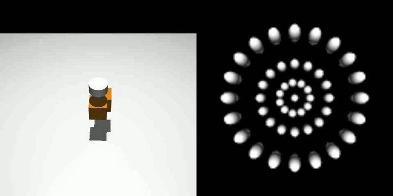
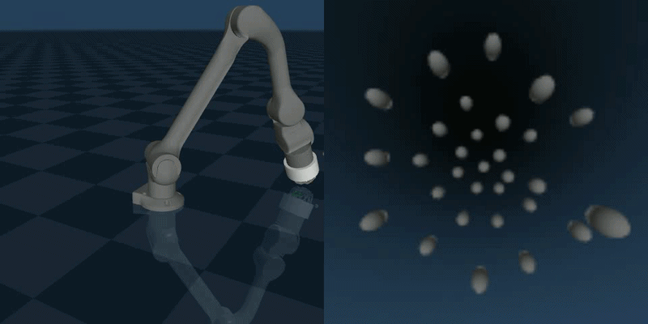

# TacTip-gym

MuJoCo simulation of a TacTip tactile sensor (based on the <a href="https://github.com/shepai/Robot_foot">robot foot repo</a>) with a set of reinforcement learning tasks built on a robot arm.

The simulator models the TacTip's silicone skin as a mesh of points with a flexible structure, so the sensor deforms like a soft body. Our <a href="https://shepai.github.io/tutorials/softbodies.html">tutorial page</a> explains how this was built.




## Features

- Gymnasium-style API (`reset()` / `step()`), compatible with PPO, SAC and other standard RL libraries
- Soft-body TacTip simulation with marker-based tactile observations
- Two observation modes for every task: **privileged** (true object and goal state) and **tactile** (TacTip markers and the arm's own position only)
- A 6-DoF robot arm controlled through the fingertip, with a smooth Cartesian controller: no drift, no IK jumps, and the fingertip moves at the speed it is asked to
- Four manipulation tasks: edge following, peg pushing, shape insertion and incline pushing
- Peg, shape and edge episodes start with the sensor already touching the object
- Progress-based rewards, so agents learn to finish the task rather than hover near the goal
- Randomised starts, shapes and surface friction, so policies cannot memorise a single scene
- An optional event-based tactile layer: a dense grid of touch sensors ("taxels") over every object and plane, read out as neuromorphic-style events
- Training scripts for Stable-Baselines3, plus a check script that tests each task before you spend hours training

## Installation

Navigate to the folder where you downloaded the repo and run:

```bash
pip install -e .
```

The training scripts in `examples/RL tasks/` also need:

```bash
pip install stable-baselines3 torch opencv-python tqdm rich
```

The arm environments only use the official `mujoco` package. `dm_control` is only loaded if something asks for the legacy `env.physics` attribute.

## Environments

Every task builds on a shared `RobotArmEnv` base class, which owns the arm, the controller, the observation modes and the reset logic. Each task supplies its own scene, task state, reward and success / failure rule.

| Gym ID | Class | Goal | Observation (privileged / tactile) | Action | Episode | Success |
|--------|-------|------|------------------------------------|--------|---------|---------|
| `TacArm-edge` | `Edge` | Start touching the top edge of a randomly rotated block and follow it all the way round | 22 / 435 | 3 (x, y, z) | 400 steps (8 s) | One full anticlockwise lap |
| `TacArm-peg` | `Peg` | Start touching an upright cylinder and push it into a hole | 20 / 434 | 2 (x, y) | 250 steps (5 s) | Cylinder drops into the hole |
| `TacArm-shape` | `ShapeInsertion` | Start touching one of four shapes and push it into its own hole | 25 / 434 | 2 (x, y) | 300 steps (6 s) | Shape goes into the correct hole |
| `TacArm-hill` | `Incline` | Intercept a ball rolling down a ramp whose friction changes each episode, then push it to the top | 23 (24 with friction) / 434 | 2 (along / across the slope) | 300 steps (6 s) | Ball within 4 cm of the top |

Tactile sizes are for the 71-marker TacTip (213 marker values). The policy runs at 50 Hz: each environment step is 20 MuJoCo steps of 1 ms.

There are also two basic environments that are registered with Gymnasium:

- `RandomTac-v0`: the standalone TacTip with randomly placed boxes
- `RobotArm-v0`: the TacTip on the robot arm with the same controller as the tasks, and no task (zero reward, never terminates)

Every arm environment accepts these keyword arguments through `gym.make(...)`:

| Argument | Default | Meaning |
|----------|---------|---------|
| `privileged` | `True` | `True`: true task state. `False`: TacTip markers + proprioception |
| `events` | `False` | Append taxel events to the observation (see below) |
| `max_steps` | per task | Override the episode length |
| `start_touching` | `True` | `Peg` / `ShapeInsertion`: start in contact with the object |
| `spawn_yaw` | `0.1` | `ShapeInsertion`: starting rotation range in radians (pi = needs re-orienting) |
| `spawn_toward_hole` | `0.0` | `ShapeInsertion`: 0 = start in the middle, 1 = start in line with the correct hole |
| `observe_friction` | `False` | `Incline`: add the true friction level to the observation |

### Observation modes

Both modes start with the same short **proprioception** block, because a real robot always knows where its own arm is:

- fingertip position (3)
- commanded fingertip position minus measured fingertip position, divided by 1 cm (3). When the fingertip is pressed against something it lags behind the command, so this acts as a rough force sense
- the smoothed velocity command the arm is following (2, or 3 for edge following)

After that:

- **Privileged** (default): the task state, such as object position, vector to the goal, object velocity and whether the sensor is touching. Each task's list is below.
- **Tactile:** marker displacement from the untouched sensor (3 values per marker, in mm), then the change in each marker since the previous step (3 per marker, in mm). The object and the goal are never given directly.

```python
env = gym.make("TacArm-peg", privileged=False)   # tactile from the start (use this for training)
env.unwrapped.set_privileged(True)               # or switch later; rebuilds env.observation_space
```

The observation space is rebuilt from a real observation, so its size can never get out of step with what `step()` returns. Call `set_privileged()` before wrapping the env in a `VecEnv` or `VecNormalize`. For vectorised training, pass `privileged` through `env_kwargs` instead.

The markers are read by `get_nodes()`, which returns every `s_c*` marker site in the sensor's own (`ee_site`) frame. The untouched marker positions are recorded once, when the environment is built, with the arm in free space.

Privileged mode is the quickest way to check that a task, reward and controller can be learned at all. Tactile mode is the setting a real robot faces.

### How the arm is controlled

The policy does not command joints. Each action component lies between -1 and 1 and is read as a fingertip velocity:

```python
velocity_cmd = 0.6 * velocity_cmd + 0.4 * action    # light low-pass filter (ACTION_SMOOTHING)
target      += velocity_cmd * 0.005                  # 5 mm per step at full speed (ACTION_SCALE)
```

Then, every step:

1. **Leash.** The commanded target may not run more than 1 cm (`LEASH`) ahead of the measured fingertip, so it stops instead of running away when the fingertip is blocked. It is never pulled back towards the fingertip, so a sagging arm cannot drag the command down with it.
2. **Inverse kinematics.** A few iterations of damped least-squares IK turn the target into angles for joints 1 to 6, holding the sensor orientation at `TARGET_QUAT = [1, 0, 0, 0]`. The IK runs on a scratch copy of the simulation data and starts from the previous joint **command**, not the measured joints, so the arm stays in one configuration and does not creep.
3. **Feed-forward.** The arm's joint servos are stiff spring-dampers that lag a tenth of a second behind any motion and sag under gravity on their own, so the joint targets get a velocity term and a gravity term added.
4. **Simulation.** The joint targets are blended in over 20 physics steps (`FRAME_SKIP`).

The action smoothing matters for learning. Early in training the actions are mostly exploration noise, and unfiltered noise jerks the fingertip back and forth, which tips the peg over almost every time. With the filter, a roughly correct policy plus the same noise succeeded 12 times out of 16, against 0 without it.

Action layouts:

- **Peg / ShapeInsertion:** x and y. The fingertip height is held 1.5 cm above the platform (`PUSH_Z`), low on the object, so it slides rather than tips.
- **Incline:** along the slope and sideways, in the ramp's own coordinates. The height follows the ramp surface so the fingertip stays level with the ball's centre.
- **Edge:** x, y (up to 4 mm per step) and z (up to 1.5 mm per step, for fine control of contact depth).

### Resets

1. The simulation is reset and the task randomises and places its objects.
2. The arm is teleported to an IK solution for the start pose, just clear of the object, and held still for 100 physics steps. Teleporting avoids swinging the arm across the scene.
3. For edge, peg and shape, the fingertip creeps towards the object (about 1 mm every 10 ms) until the sensor touches it. If a light object is nudged away and contact is lost, it retries with finer steps.

So these episodes start with the sensor touching the object, which is essential in tactile mode. The incline is the exception by design: the fingertip is placed on the lower half of the ramp and the ball is dropped above it, so the episode begins with the ball rolling down.

### Rewards

All four tasks use the same recipe. Each step's reward is roughly between -1 and 1 and is mostly **progress**, meaning how much closer the task got to being done during that step:

```python
progress = clip((previous_distance - current_distance) / 0.005, -1, 1)   # 1 = full-speed progress
closeness(d, sigma) = 1 - tanh(abs(d) / sigma)                            # small guiding terms
```

- **Success:** +100 (`R_SUCCESS`) and the episode ends.
- **Unrecoverable failure:** -10 (`R_FAIL`) and the episode ends.

All terms depend only on the current state, with no hidden stage counters. An earlier version paid mainly for being *near* the goal. A policy that did nothing then scored 103 over a peg episode, while noisy pushing attempts scored 16 to 56 because they often tipped the cylinder, so the agent learned to sit still. Paying for progress fixes this.

### Edge following

The block is randomly rotated each episode and the start point is chosen at random on one of the top edges, at least 1.5 cm from a corner. The fingertip is lowered onto the edge until it touches. The contact height is recorded, and the agent is rewarded for keeping that depth. The top of the block is treated as a 0.6 m loop: for any fingertip position the environment finds the closest point, its distance round the loop (arc length), the sideways error and the anticlockwise edge direction.

- **Privileged observation (22):** proprioception (9), block centre relative to the fingertip (2), sine and cosine of the block's rotation (2), nearest edge point relative to the fingertip (2), edge direction (2), sideways error, height error, distance to the next corner, fraction of the lap completed, and touching (5)
- **Reward:** `0.10 * on_edge + 0.05 * touching + 0.05 * depth + 0.80 * on_edge * touching * progress`, where `on_edge = closeness(sideways_error, 5 mm)`, `depth = closeness(height_error, 3 mm)` and progress is the change in arc length (going the wrong way round is negative)
- **Success:** +100 after one full lap (`LAP_FRACTION`)
- **Fail:** -10 if the fingertip is more than 2.5 cm from the edge, lifts more than 2 cm, or slips more than 1.5 cm down the side

### Peg

An upright cylinder (4 cm wide) sits on a platform with a 6 cm hole (1 cm clearance per side). It starts 8 to 12 cm from the hole and up to 2 cm to either side, with the fingertip touching it on the side facing away from the hole.

- **Privileged observation (20):** proprioception (8), cylinder position (3), vector from cylinder to hole (2), vector from cylinder to fingertip (2), cylinder tilt (2), cylinder velocity (2), touching (1)
- **Reward:** `0.1 * closeness(tip - push_point, 2 cm) + 0.2 * closeness(goal_dist, 8 cm) + 0.7 * progress(goal_dist)`. The push point is on the far side of the cylinder from the hole and is recomputed every step
- **Success:** +100 when the cylinder is over the hole and has dropped 1.5 cm
- **Fail:** -10 if the cylinder tips more than about 30 degrees, is lying on its side, or leaves the platform anywhere other than the hole. Tipping is ignored while it is over the hole, because it tilts as it drops in

MuJoCo cannot cut a hole in a solid, so the platform is built from four box slabs around a gap.

### ShapeInsertion

The platform has four holes (circle, square, rectangle and triangle). Each episode one of the four shapes is shown, with a random start position and rotation, and the fingertip starts touching it. The agent must push it to its own hole. In tactile mode it is not told which shape it has, so it has to identify the shape by touch.

- **Hidden shapes:** all four shapes exist in the scene, but three are hidden each episode: transparent, collisions off, and put back in their parking spot after every step. Setting gravity compensation at runtime has no effect unless the model was built with it.
- **Generated holes:** `shape_config.py` writes the scene XML from one shared configuration, so the Python code and the geometry cannot drift apart. Run `python shape_config.py` to regenerate it.
- **Privileged observation (25):** proprioception (8), shape position (3), sine and cosine of (symmetry order × yaw) and the yaw error (3), vector to the target hole (2), vector from shape to fingertip (2), shape velocity (2), touching (1), one-hot shape identity (4)
- **Symmetry-aware yaw error:** the yaw error wraps by each shape's rotational symmetry (circle: none, square: 90 degrees, rectangle: 180 degrees, triangle: 120 degrees), so rotations that already fit are not penalised.
- **Reward:** `0.10 * closeness(tip - push_point, 2 cm) + 0.15 * closeness(goal_dist, 12 cm) + 0.60 * progress(goal_dist) + 0.15 * near * closeness(yaw_error, 0.15 rad)`, where `near` rises from 0 to 1 over the last 10 cm to the hole
- **Success:** +100 when part of the shape is at least 8 mm below the plate surface (`INSERT_DEPTH`) within 3 cm of the correct hole
- **Fail:** -10 for the wrong hole or going off the edge, tipping over more than 5 cm from the target, or lying on the plate

Success is measured from the shape's lowest point because, with a 2 cm plate and 4 mm clearance, a pushed shape tips forward at the hole and wedges in at an angle instead of dropping straight through. A shape lying flat on the plate never has any part below the surface, so it cannot be mistaken for an insertion. Orientation is still enforced by the physics: a square rotated 45 degrees cannot go into the square hole.

### Incline

The fingertip starts on the lower half of a 15 degree ramp and a ball is dropped further up. The agent has to intercept the ball as it rolls down without letting it slip past, then push it back up to the top. Pushing a ball uphill with one rounded fingertip is unstable, so it has to keep correcting sideways. The ramp friction is randomised each episode:

- sliding friction from 0.05 to 1.0 (log scale)
- rolling friction from 0 to 0.008 (linear)

Low friction means the ball rolls back down as soon as the push stops, so the agent has to push continuously. High friction means the ball holds its place, so short pushes are enough. The friction is hidden from the policy by default, so it has to be inferred from how the ball moves.

- **Privileged observation (23):** proprioception (8), fingertip position in slope coordinates (3), ball position in slope coordinates (3), fingertip offset from the ball (2), ball velocity in slope coordinates (3), ball spin times its radius (3), touching (1). `observe_friction=True` adds the friction level as a 24th value.
- **Reward:** `0.15 * closeness(tip - point_below_ball, 3 cm) + 0.25 * ball_height + 0.60 * progress(ball_height)`. The ball is rolling down at the start, so progress is negative until the agent stops it, which pushes the agent to meet the ball early.
- **Success:** +100 when the ball is within 4 cm of the top
- **Fail:** -10 if the ball rolls off the bottom, goes more than 10 cm sideways, or pops off the surface
- **Evaluation:** fix the friction with `env.reset(options={"friction": 0.0})`

## Quick start

Run a task with random actions in the MuJoCo viewer:

```python
import time
import gymnasium as gym
import mujoco.viewer
import tactip_mujoco_gym  # triggers register()

env = gym.make("TacArm-peg")                    # add privileged=False for tactile observations
raw = env.unwrapped
obs, info = env.reset(seed=0)
dt = raw.FRAME_SKIP * raw.model.opt.timestep    # 0.02 s per step

with mujoco.viewer.launch_passive(raw.model, raw.data) as viewer:
    while viewer.is_running():
        action = env.action_space.sample()
        obs, reward, terminated, truncated, info = env.step(action)
        viewer.sync()
        time.sleep(dt)
        if terminated or truncated:
            print("success" if info["is_success"] else "episode over")
            obs, info = env.reset()
```

`info` contains `is_success` plus task details such as `goal_dist`, `touching`, `friction` or `laps`.

You can view the image from the camera inside the sensor with:

```python
import cv2
img = raw.get_tactile_image()                   # float32 RGB in [0, 1]
cv2.imshow("sensor_cam", cv2.cvtColor(img, cv2.COLOR_RGB2BGR))
cv2.waitKey(1)
```

`RandomTac-v0` is the standalone sensor. It keeps the original interface: its observation is a dictionary `{"image": (H, W, C)}` from the sensor camera, and there are no actions that make changes, because it is just the basic sensor.

## Training

The examples in `examples/RL tasks/` wrap Stable-Baselines3:

| File | Purpose |
|------|---------|
| `RL_BASE.py` | `run()`, `evaluate()`, `visualise()` and the training-video callback |
| `edge_following.py`, `peg_insertion.py`, `shape_insertion.py`, `incline_ball.py` | One script per task: set `PRIVILEGED` and the step count, then run |
| `check_envs.py` | Checks each task before training (see below) |

```python
from RL_BASE import run, evaluate, visualise

if __name__ == "__main__":          # required: each environment runs in its own process
    run("TacArm-peg", "peg_v2", "peg_v2", 3_000_000, privileged=True)    # or privileged=False
    evaluate("TacArm-peg", "peg_v2", n_episodes=50)                      # success rate, no viewer
    visualise("TacArm-peg", "peg_v2")                                    # MuJoCo viewer
```

`run()` creates one environment per process (`SubprocVecEnv`), normalises observations and rewards with `VecNormalize`, writes `logs/<name>/progress.csv`, saves a checkpoint every 500k steps and records a short video at every 20% of training. Extra environment arguments go in `env_kwargs`, e.g. `run(..., env_kwargs={"spawn_yaw": 0.5})`, and `algo="SAC"` switches algorithm. It saves, in both `logs/<name>/` and `models/`:

- `<name>.zip`: the policy
- `<name>_vecnormalize.pkl`: the observation statistics. The policy was trained on normalised observations and acts almost randomly without them, so these are saved **after** training and loaded by `evaluate()`, `visualise()` and the videos.
- `<name>.json`: environment name, arguments and algorithm, so the same environment is rebuilt for evaluation

Default PPO settings: 8 environments, 1024 steps each per update, minibatch 512, 10 epochs, learning rate 3e-4, gamma 0.99, GAE lambda 0.95, clip 0.2, target KL 0.03, separate 256 x 256 tanh policy and value networks, initial action standard deviation 0.6.

### Check an environment first

```bash
python check_envs.py              # all tasks
python check_envs.py TacArm-peg   # one task
```

For each task it reports whether the arm drifts or lags, how often resets start in contact, the score of random actions, the environment speed, and the success rate of a simple hand-written controller that uses the privileged state. If the hand-written controller cannot solve a task, a learned policy will not either. If it fails after a change to the sensor or scene, the constants to look at are `TARGET_QUAT`, `TIP_R`, `PUSH_Z`, `Incline.TIP_H`, `HOME_TIP` and `WS_LO` / `WS_HI` in `robot_arm.py`.

### Results

Success rate over the last 100 training episodes, with PPO:

| Task | Observations | Success rate |
|------|--------------|--------------|
| Edge following (one full lap) | Privileged | 83% after 70k steps, 100% after 86k |
| Peg | Privileged | 67% after 45k steps, 92% after 86k, 98% after 287k |
| Incline | Privileged, friction hidden | 54% after 70k steps, 87% after 135k, 94% after 164k |
| Peg | Tactile only | 57% after 70k steps, 82% after 400k (still improving) |
| ShapeInsertion (central start) | Privileged | 27% after 100k steps, 53% after 500k (still improving) |

The first version of the incline task stayed at 3 to 5% success over a million training steps. These runs used a stand-in arm (a Unitree Z1 with a simplified 37-marker TacTip) and a minimal PPO implementation with the same normalisation and loss, so exact numbers on the full TacTip model will differ.

## Event-based tactile layer (taxels)

On top of the TacTip, any object or plane in a scene can be covered in a dense grid of touch sensors, called taxels. Each taxel reports the normal force on its patch of surface. These can be read as raw forces or as **events**, which only fire when a taxel's force changes, like a neuromorphic or event-camera sensor. A steady load, such as an object resting on the platform, produces no events.

### 1. Generate the taxels

`add_events.py` (in `src/tactip_mujoco_gym/assets/scripts/`) reads a worldbody include file, adds thin touch-sensor sites over every geom, and writes a file of matching `<touch>` sensors:

```bash
python add_events.py shape_worldbody.xml --assets shape_assets.xml \
       --out shape_worldbody_tx.xml --sensors shape_sensors.xml
```

- Supported geoms: boxes, cylinders, spheres and the triangular prism mesh. Planes are skipped.
- The input must be a file with a `<mujoco>` root and `<body>` elements, which is the include-file pattern used by the scenes. Move inline bodies (such as the edge-following block) into their own file first.
- Spacing and covered faces are set by the `RULES` table at the top of the script. By default objects get 4 mm spacing over the whole surface, and platforms and ramps get 10 mm on the top face only.
- The script prints the taxel count per geom. Thousands of taxels slow the simulation, so check the cost and raise the spacing if needed.

Then use the `_tx` file in the scene in place of the original, and include the sensors:

```xml
<worldbody>
  <include file="shape_worldbody_tx.xml"/>
</worldbody>

<sensor>
  <include file="shape_sensors.xml"/>
</sensor>
```

### 2. Turn events on

```python
env = gym.make("TacArm-peg", events=True)    # at construction (use env_kwargs={"events": True} with run())
env.unwrapped.set_event(True)                # or later; grows env.observation_space
```

Turn events on **before** creating the policy, because it changes the observation size. `set_event(False)` turns them off again.

When events are on, the observation gains one value per taxel: the signed event count since the previous step (+1 per force increase, -1 per decrease, clipped to ±5). Events fire when a taxel's force changes by at least `EVENT_THRESHOLD` (0.02 N by default, or `set_event(True, threshold=...)`). Taxels are sampled after every physics step, not just every environment step.

While events are off, MuJoCo's sensor evaluation is switched off entirely (if every sensor in the model is a taxel), because computing thousands of unused touch sensors is a large part of the simulation cost. In the peg scene this made each physics step about 3.4 times faster.

### 3. Reading events and forces

| Method (on `env.unwrapped`) | Returns |
|-----------------------------|---------|
| `get_events()` | Events since the last call, as `[taxel_index, polarity, time]` rows. Independent of the event counts in the observation, so it is safe to use alongside them |
| `get_taxel_forces()` | Current normal force on every taxel |
| `taxel_positions()` | World position of every taxel |
| `taxel_bodies()` | Name of the body each taxel is on |
| `taxel_names` | Name of every taxel sensor (after `set_event(True)`) |

Touch sensors give normal force only (no shear), so the layer produces a pressure map.

### Viewing the taxels

The taxel sites are in site group 4, which the viewer hides by default. In the MuJoCo viewer, press **Shift + 4**, or tick group **4** under *Site groups* in the Rendering panel. From Python, set `viewer.opt.sitegroup[4] = 1`.

## Training tips

- **Privileged first.** Train in privileged mode to confirm the task and reward work, then move to `privileged=False`.
- **Curriculum.** For `ShapeInsertion`, start with `spawn_toward_hole=1.0` (straight pushes) and the default small `spawn_yaw`, then move to central starts, then larger rotations up to pi. A single shape can be fixed with `env.reset(options={"shape": "square"})`. For `Incline`, fix the friction with `options={"friction": ...}` and widen the range gradually. `start_touching=False` makes the agent find the object first.
- **Hidden friction.** In privileged mode the ball's velocity and spin were enough to learn the incline without frame stacking. In tactile mode the ball is only felt once it touches the sensor, so frame stacking or a recurrent policy may help.
- **Speed.** Keep events off unless you need them. `run()` already uses one process per environment. If the simulation is slow, try `algo="SAC"`, which usually needs fewer environment steps.
- **Evaluation.** Always evaluate with the saved `VecNormalize` statistics. `evaluate()` and `visualise()` do this for you.
- **Time limits** are reported as `truncated`, not `terminated`, so the value function bootstraps correctly.

## Adding your own task

A new task needs a MuJoCo scene file and a class that inherits from `RobotArmEnv`. The base class handles the controller, both observation modes, the marker readout, taxel events, the success and failure bonuses and the episode length. The task fills in these hooks:

- `_setup_task()`: look up the bodies and joints it needs, once
- `_reset_task(options)`: place the objects, then the arm. `self._place_arm(tip_position)` teleports the arm by IK and lets it settle, and `self._approach(direction, body_id)` creeps into contact
- `_privileged_obs()`: the task state for privileged mode (proprioception and markers are added for you)
- `_reward()`: the per-step reward. `self._delta(key, distance)` gives the clipped progress term
- `_status()`: return `"success"`, `"fail"` or `None`

Optional: `_apply_action()` for a different action layout (as `Incline` does), `_post_physics()` for anything that must happen after each step, and `_task_info()` for extra `info` entries. The observation space is sized automatically from a real observation, so there is no observation dimension to keep in sync by hand.

## Links

- Project page: <a href="https://shepai.github.io">shepai.github.io</a>
- Soft body tutorial: <a href="https://shepai.github.io/tutorials/softbodies.html">shepai.github.io/tutorials/softbodies.html</a>
- Robot foot repo: <a href="https://github.com/shepai/Robot_foot">github.com/shepai/Robot_foot</a>